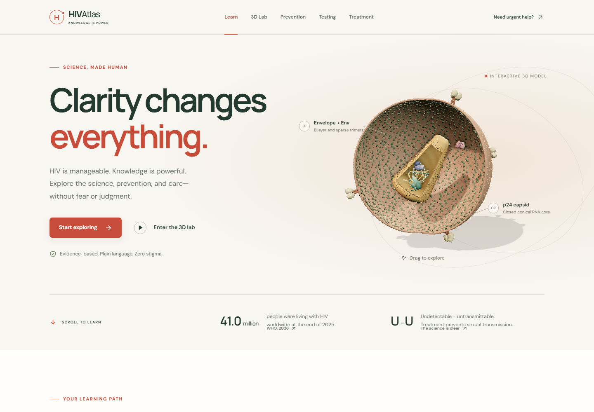
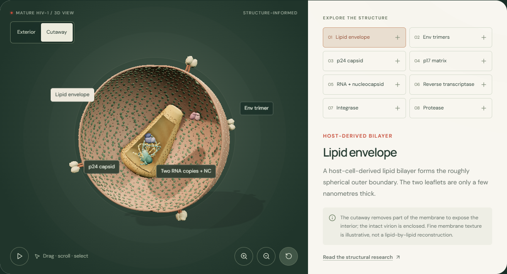

<div align="center">
  

  # HIV Atlas

  **Clarity changes everything.**

  Science, made human. An interactive, stigma-free guide to HIV education,<br />
  prevention, testing, treatment, and living well.

  <p>
    <a href="#what-makes-it-different">Explore</a> ·
    <a href="#quick-start">Quick start</a> ·
    <a href="#the-3d-laboratory">3D laboratory</a> ·
    <a href="./docs/architecture.md">Architecture</a> ·
    <a href="./docs/scientific-model.md">Scientific model</a>
  </p>

  <p>
    
    
    
    
  </p>
</div>

<br />



## A clearer way to understand HIV

HIV Atlas turns trustworthy health information into an experience people can explore at their own pace. It combines plain-language education, interactive decision tools, and a structure-informed 3D virion—without fear, judgment, or information overload.

> **Evidence-based. Plain language. Zero stigma.**

### What makes it different

| Learn by exploring | Understand the structure | Take the next step |
| --- | --- | --- |
| Six guided chapters, a transmission fact explorer, and a private knowledge check. | Rotate, zoom, select, and open a mature HIV-1 virion through a true geometric cutaway. | Compare testing windows, review prevention options, find official resources, and save a fact sheet. |
| Progress stays in the browser. | Eight selectable structures with research-linked explanations. | Responsive layouts and keyboard alternatives keep core actions within reach. |

## Inside the experience

- **Guided learning path** — HIV basics, transmission, prevention, testing, treatment, and living well.
- **Interactive 3D laboratory** — exterior and cutaway views, animated labels, mesh selection, zoom, reset, and a seven-stage life-cycle view.
- **Testing-window explorer** — compare antibody, antigen/antibody, laboratory, and nucleic acid tests across a 0–90 day timeline.
- **Prevention guidance** — condoms, PrEP, PEP, ART and U=U, sterile equipment, and specialist-supported pregnancy care.
- **Private knowledge check** — six questions with explanations; answers do not leave the device.
- **Downloadable summary** — generate a plain-language PDF fact sheet in the browser.
- **Inclusive interaction design** — responsive layouts, visible focus states, keyboard controls, reduced-motion support, and a static WebGL fallback.

## The 3D laboratory



The model replaces generic virus imagery with a scientifically informed teaching illustration:

| Component | Representation |
| --- | --- |
| Lipid envelope | Approximately spherical, subtly organic host-derived bilayer |
| Env trimers | 14 sparse, nonuniform trimers; three gp120 heads and three gp41 components each |
| p17 matrix | Thin, discontinuous membrane-associated protein patches |
| p24 capsid | Closed, asymmetric fullerene cone with 12 pentamers and a subtle CA lattice |
| Genome | Two condensed, intertwined single-stranded RNA copies with nucleocapsid protein |
| Enzymes | Distinct RT and integrase inside the capsid; protease inside the virion but outside the capsid |

**The cutaway is sectional geometry, not whole-particle transparency.** Closed and teaching-window variants preserve the distinction between the intact particle and the educational section.

Read the [model decisions and research references](./docs/scientific-model.md).

## Quick start

### Requirements

- Node.js 20+
- npm
- A modern browser with WebGL support for the interactive 3D view

### Run locally

Clone this repository, then:

```bash
cd hiv-atlas
npm ci
npm run dev
```

Open **http://localhost:5173**.

### Build for production

```bash
npm run build
npm run preview
```

The production site is generated in `dist/`. It is a client-side application with no required backend, account, API key, or environment variable.

## Project map

```text
hiv-atlas/
├── public/                    # Static assets and favicon
├── src/
│   ├── App.jsx                # Learning experience and interface
│   ├── Scene.jsx              # Renderer, camera, lighting, picking, fallback
│   ├── data.js                # Educational content and source links
│   ├── styles.css             # Responsive visual system
│   └── three/
│       ├── createVirion.js    # Assembly and component visibility
│       └── virionGeometry.js  # Custom geometry and molecular representations
├── tests/                     # Anatomy, content, interaction, and layout checks
├── docs/                      # Technical and scientific documentation
└── vite.config.js             # Vite configuration
```

See the [technical architecture guide](./docs/architecture.md) for rendering, state, cleanup, accessibility, and performance details.

## Available commands

| Command | Purpose |
| --- | --- |
| `npm run dev` | Start the Vite development server |
| `npm test` | Run content and scientific-geometry tests |
| `npm run build` | Create the production build |
| `npm run preview` | Preview the production build locally |

### Browser regression checks

With the development server running at `127.0.0.1:5173`:

```bash
node tests/interactions.mjs
node tests/model-check.mjs
node tests/layout-check.mjs
node tests/visual-check.mjs
```

These scripts use Playwright and currently point to the local Windows Chrome installation. Update their `executablePath` when running on another platform.

## Accessibility and privacy

HIV Atlas provides keyboard-operable controls, semantic dialogs and tabs, touch-sized actions, reduced-motion handling, and a static fallback when WebGL is unavailable. Chapter progress is stored locally in the browser. Quiz answers are not sent to a server.

These measures support accessibility but do not constitute a formal WCAG conformance audit.

## Scientific and medical scope

HIV Atlas is an educational resource, **not a diagnostic tool or a substitute for professional medical care**. The virion is a schematic teaching model—not an atomic-resolution reconstruction, molecular simulation, or exact scale model.

Educational content links to WHO, CDC, NIH, and peer-reviewed structural biology sources. Anyone concerned about a possible exposure should seek qualified medical care promptly; PEP must be started as soon as possible and no later than 72 hours after a possible exposure.

## Verification

The current release has been checked with:

- 13 content and scientific-geometry tests
- Production compilation
- Desktop and mobile interaction checks at 320–1440 px
- Camera controls, mesh picking, lifecycle navigation, and WebGL context-loss fallback
- Live reduced-motion preference changes and paused idle-render behavior

---

<div align="center">
  <strong>Knowledge is powerful. Compassion makes it useful.</strong><br />
  HIV Atlas · Science, made human.
</div>
