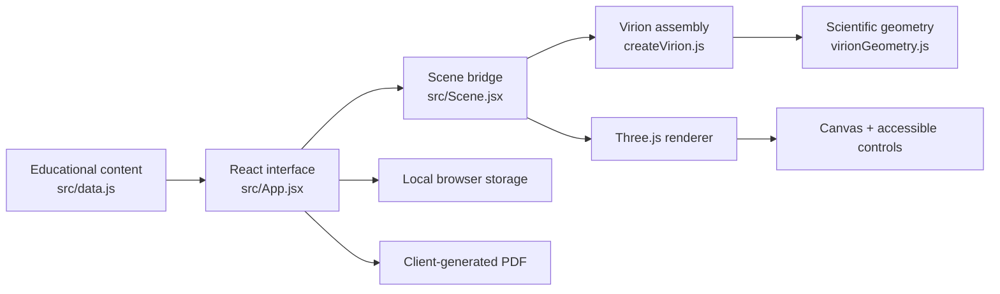
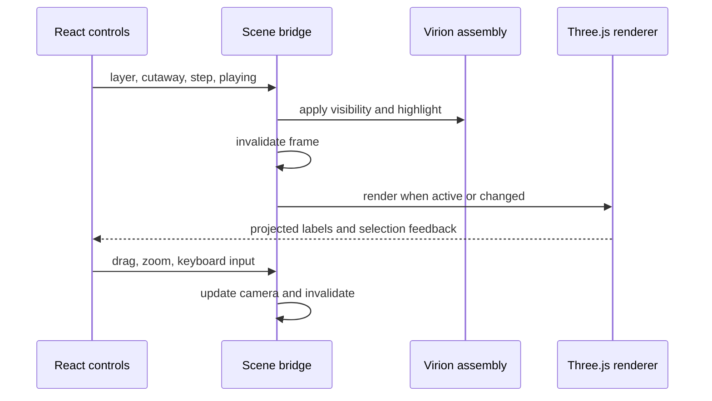

# Technical architecture

HIV Atlas is a static React application with an imperative Three.js rendering layer. Educational content, interface state, and scientific geometry remain separate so each can be reviewed independently.

[Back to the README](../README.md)

## System overview

## Runtime stack

| Layer | Technology | Responsibility |
| --- | --- | --- |
| Interface | React 19 | Sections, dialogs, tabs, selections, progress, and educational tools |
| Build | Vite 6 | Development server and production bundling |
| 3D rendering | Three.js 0.174 | Geometry, physical materials, lighting, camera, and post-processing |
| Icons | Lucide React | Consistent interface iconography |
| PDF export | jsPDF | Browser-side fact-sheet generation, loaded on demand |
| Browser checks | Playwright | Interaction, layout, rendering, and fallback verification |
| Unit checks | Node test runner | Content integrity and scientific-geometry invariants |

## Source ownership

### `src/App.jsx`

Owns the learning experience and all interface-level controls:

- Guided chapters and local progress
- Transmission filters and prevention selection
- Testing-window explorer
- Anatomy and lifecycle tabs
- Exterior/cutaway, play/pause, zoom, and reset controls
- Component detail panels and research links
- Quiz, glossary, emergency dialog, and PDF summary

The application uses section anchors rather than a router. Chapter progress uses the `hiv-atlas-progress-v1` local-storage key.

### `src/Scene.jsx`

Bridges React props to the Three.js lifecycle. Its responsibilities include:

- Renderer, scene, camera, controls, lighting, shadows, and SSAO
- Responsive model scaling and resize handling
- Raycast selection against visible selectable meshes
- Projected annotation positions
- Keyboard camera alternatives
- Delta-time animation and invalidation-based rendering while paused
- Reduced-motion preference changes
- WebGL failure and context-loss fallback
- GPU and DOM cleanup

The component exposes `resetCamera()`, `zoomIn()`, and `zoomOut()` through a ref. React owns the selected layer and view mode; the scene applies those values to the model.

### `src/three/createVirion.js`

Assembles the complete particle and its teaching variants. It manages:

- Full and sectioned envelope groups
- Full and sectioned Env trimers
- Full and sectioned matrix patches
- Closed capsid and capsid teaching window
- Genome, reverse transcriptase, integrase, and protease placement
- Component highlighting
- Lifecycle visibility
- Reset and disposal behavior

Reverse transcriptase and integrase are children of the capsid assembly. Protease belongs to the virion group outside the capsid.

### `src/three/virionGeometry.js`

Contains reusable geometry and material construction:

- Indexed, position-welded bilayer shells
- Closed and sectioned asymmetric capsid surfaces
- Outward-facing CA lattice markers
- Sparse trimeric Env assemblies
- Discontinuous matrix patches
- Condensed RNA tube curves and NC markers
- Molecular-style enzyme representations
- Organic shader variation
- Geometry, material, and instanced-mesh disposal

### `src/data.js`

The editorial source of truth. It contains learning chapters, virus-layer explanations, transmission facts, testing data, prevention options, lifecycle stages, quiz questions, glossary entries, and outbound source URLs.

## Rendering lifecycle

The animation loop clamps delta time, updates controls, interpolates stage transitions, and skips unnecessary frames once a paused scene has settled. Offscreen rendering is avoided where possible.

## Sectional-model strategy

The application does not make the entire virion transparent. It constructs separate opaque geometries for intact and sectioned states:

1. Exterior mode shows the complete envelope and Env distribution.
2. Cutaway mode replaces the envelope with a welded sectional shell.
3. The p24 capsid remains closed for capsid-focused explanations.
4. Genome-focused selections open a dedicated teaching window.
5. Visibility changes preserve biological containment and component distinctions.

This approach makes the educational cut explicit without implying that a biological capsid is naturally open.

## Accessibility and failure handling

- Icon-only controls have accessible names.
- Dialogs support Escape and semantic labelling.
- The canvas has keyboard camera controls and visible UI alternatives.
- Touch targets and mobile layouts are sized for interaction.
- `prefers-reduced-motion` is observed at runtime.
- WebGL creation failures and context loss display a static scientific illustration.
- Camera controls are disabled when the static fallback is active.

No formal WCAG conformance audit is claimed.

## Performance notes

- Repeated molecular features use `InstancedMesh` where appropriate.
- Hidden objects are excluded from picking.
- Lifecycle host-cell assets are allocated only in lifecycle mode.
- Paused scenes stop rendering after transitions settle.
- PDF code is dynamically imported only when requested.
- Geometry, materials, instanced meshes, post-processing resources, shadows, controls, and renderer resources are disposed during teardown.

Vite currently reports a nonblocking large-chunk warning for the main JavaScript bundle. Further route-level or scene-level splitting is a possible optimization, not a correctness requirement for the current release.

## Verification layers

| Check | Coverage |
| --- | --- |
| `tests/content.test.js` | Layer definitions, unique IDs, and source URLs |
| `tests/virion.test.js` | Closed geometry, proportions, containment, Env counts, lifecycle visibility, disposal |
| `tests/interactions.mjs` | Learning, selection, prevention, testing, quiz, and resource interactions |
| `tests/model-check.mjs` | Picking, camera controls, fallback, reduced motion, and idle rendering |
| `tests/layout-check.mjs` | Horizontal overflow at mobile, tablet, and desktop widths |
| `tests/visual-check.mjs` | Canvas presence and browser errors |

The browser scripts currently use a Windows Chrome `executablePath`. Adjust it for the host platform before running them elsewhere.

## Deployment

Run `npm run build` and publish `dist/` on a static host. No application backend or secrets are required. Configure the host to serve the generated assets with the appropriate base path if deploying below a domain root.
